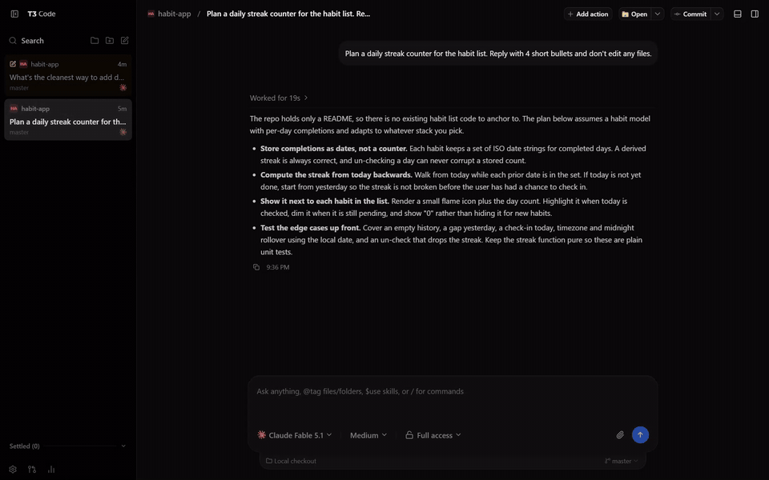
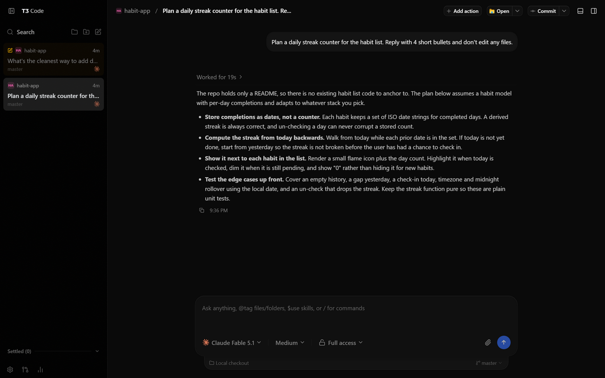
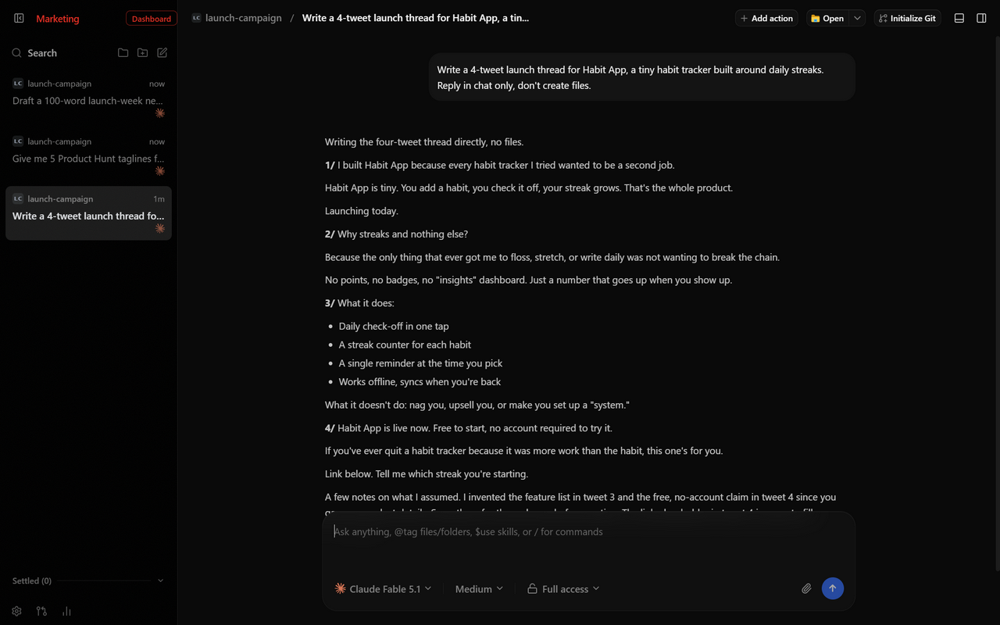
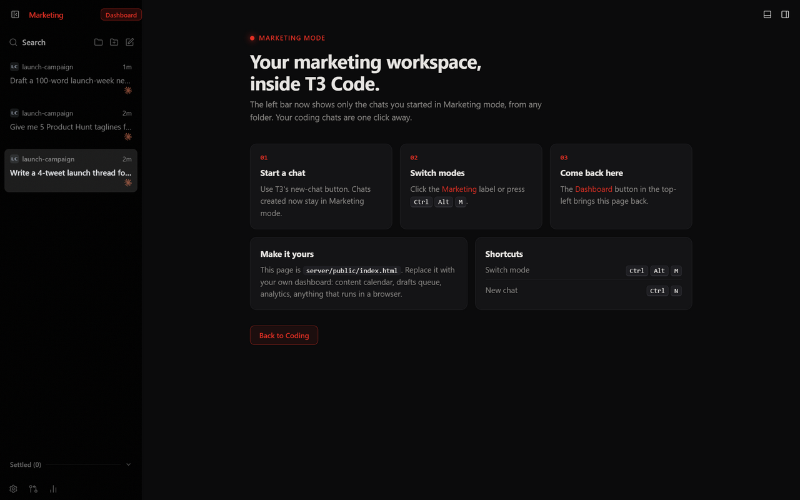
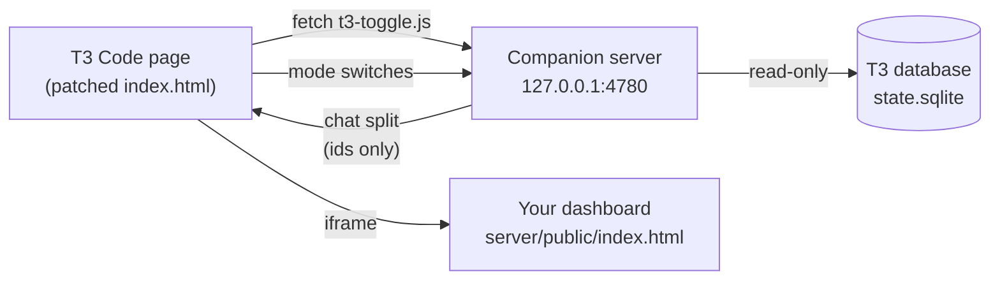

<div align="center">

# t3-marketing

**Give [T3 Code](https://github.com/pingdotgg/t3code) a second brain for marketing.**<br>
One click splits your chats into **Coding** and **Marketing**, with your own dashboard built in.<br>
Plus a fix for "Reveal in File Explorer" on Windows.




</div>

## Why

T3 Code is great for coding agents, but the same agents are just as good at launch threads, taglines and newsletters.
Mixing both in one chat list gets messy fast. This adds a mode switch: your marketing chats live in their own list,
next to a dashboard you control, and your coding chats stay exactly where they were.

## Screenshots

<table>
  <tr>
    <td width="50%"></td>
    <td width="50%"></td>
  </tr>
  <tr>
    <td align="center"><b>Coding mode</b><br>Plain T3. Only coding chats in the left bar.</td>
    <td align="center"><b>Marketing mode</b><br>A red <i>Marketing</i> label, and only marketing chats.</td>
  </tr>
  <tr>
    <td colspan="2"></td>
  </tr>
  <tr>
    <td colspan="2" align="center"><b>Your dashboard</b><br>Shown in the main area in Marketing mode. The starter page ships in <code>server/public/index.html</code>; swap in your own.</td>
  </tr>
</table>

## Features

- **Two modes, one app.** Click the "T3 Code" wordmark or press <kbd>Ctrl</kbd>+<kbd>Alt</kbd>+<kbd>M</kbd> to switch.
- **Chats remember their mode.** A chat belongs to the mode it was created in, whatever folder it's in.
- **Bring your own dashboard.** Any web page: content calendar, drafts queue, analytics. A **Dashboard** button brings it back.
- **Hot reload.** The toggle re-fetches itself every 30 s, so edits apply without restarting T3.
- **Fails safe.** If the companion server isn't running, T3 behaves exactly as stock.
- **Fully reversible.** `--undo` restores T3's original bytes; a backup is kept next to the archive.
- **Bonus:** fixes "Reveal in File Explorer" / "Open in..." on Windows.

## Quick start

```bash
git clone https://github.com/manuvamp/t3-marketing
cd t3-marketing

node server/server.mjs              # 1. companion server on 127.0.0.1:4780 (keep it running, e.g. at login)
node patches/toggle-loader.cjs      # 2. add the toggle to T3 (re-run after T3 updates)
node patches/reveal-fix.cjs         # 3. optional: Windows "Reveal in File Explorer" fix
```

Then fully quit T3 Code (tray icon too) and reopen it. To remove the toggle: `node patches/toggle-loader.cjs --undo`.

## How it works



T3 ships its server and web UI inside `%LOCALAPPDATA%\Programs\t3code\resources\server.asar`. Each patch swaps a
byte string in that archive for another of **exactly the same length**, so no archive offsets move. That is only safe
because T3's Electron build has the `EnableEmbeddedAsarIntegrityValidation` fuse off; both scripts check the fuse and
refuse to patch if it's on. Each script backs up the archive the first time (`server.asar.bak-reveal`,
`server.asar.bak-toggle`) and refuses if its anchor text isn't found exactly once (meaning T3 changed and the patch
needs updating).

**The toggle.** T3's page (`apps/server/dist/client/index.html`) starts with an inline theme script. The patch replaces
a 4-line comment in it with a same-length loader that fetches `http://localhost:4780/t3-toggle.js` and runs it inline.
T3's CSP allows inline scripts and http fetches but not cross-origin `<script src>`, hence fetch + inline.

The toggle only hides chat rows and overlays the dashboard; it never edits T3's React-owned DOM or its database. The
server reads T3's database read-only and keeps its own state in `server/data/t3-modes.json`. It accepts only
`127.0.0.1` / `localhost` Host headers (DNS-rebinding guard), and only T3's own page can record a mode switch.

The dashboard frame gets `t3m:host`, `t3m:show` and `t3m:hide` messages; post `t3m:close` to the parent to switch back
to Coding.

| Env var | Default |
| --- | --- |
| `T3_STATE_DB` | `~/.t3/userdata/state.sqlite` |
| `T3M_DATA` | `server/data` |

The port (4780) is baked into the same-length patch; changing it means changing both `server/server.mjs` and the
loader string in `patches/toggle-loader.cjs`.

## The Windows reveal fix

**Bug:** T3's server starts its PowerShell helper with `spawn({ detached: true })`. On Windows that means
`DETACHED_PROCESS` (no console), and `powershell.exe` then exits 0 without running the script. Explorer never opens,
but T3 logs success.

**Fix:** in both launch paths (editor/file manager and browser), same length, so nothing else moves:

```diff
 options: {
-    detached: true,
+    windowsHide:!0,
```

The process gets a hidden console instead of none, and the script runs.

## Optional: context for Marketing chats

`hooks/t3-chat-hook.mjs` is a Claude Code `SessionStart` hook. When a T3 chat in Marketing mode starts, it adds a short
note to the chat's context (edit `CONTEXT`, or point `T3M_CONTEXT_FILE` at a Markdown file, e.g. your brand voice).
Add it to `~/.claude/settings.json`:

```json
{
  "hooks": {
    "SessionStart": [
      { "hooks": [{ "type": "command", "command": "node \"C:/path/to/t3-marketing/hooks/t3-chat-hook.mjs\"" }] }
    ]
  }
}
```

## Project layout

```
patches/
  reveal-fix.cjs        Windows "Reveal in File Explorer" fix
  toggle-loader.cjs     adds (or --undo removes) the toggle loader in T3's page
server/
  server.mjs            companion server (127.0.0.1:4780)
  t3-modes.mjs          which chat belongs to which mode
  public/t3-toggle.js   the toggle that runs inside T3
  public/index.html     starter dashboard (replace with yours)
hooks/
  t3-chat-hook.mjs      optional Claude Code hook for Marketing chats
```

## Disclaimer

Not affiliated with T3 Code or Ping Labs. These patches modify an installed app; re-run them after every T3 update,
and use `--undo` or the backups if anything looks off. Screenshots are from a sandboxed T3 instance with demo chats.

## License

[MIT](LICENSE)
